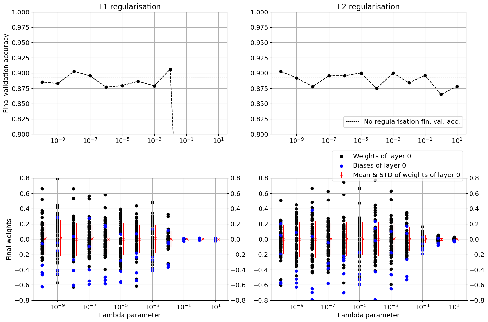
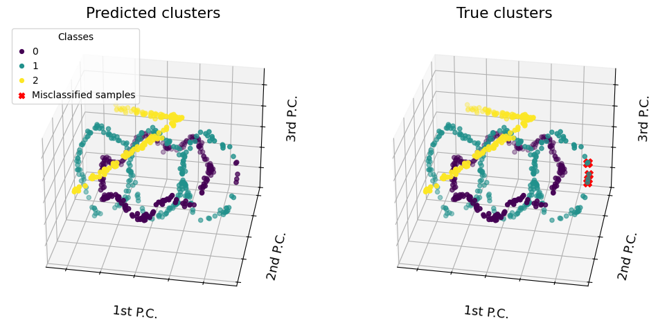

# LCP-B — Weekly assignments on Machine Learning algorithms and Neural networks

This directory contains the course's weekly assignments. For each of the four assignments, the`.pdf` file contains the given task (Prof. I. Siloi), while the Jupyter notebook (`.ipynb`) is the implementation. 

The topics covered are as follows:

| Assignment # | Topic |
|---|---|
| 1 | Deep Neural Networks | 
| 2 | Convolutional Neural Networks | 
| 3 | Boosted Trees (topic expanded in the ['paper' assignment](https://github.com/LiberoP/LCPB_2026/tree/ce2ca3093a096beab0922ba54241911c7a5a15b7/paper_clean)) | 
| 4 | Clustering | 

They are implemented using libraries `keras`, `sklearn`, and `XGBoost` among others.

---

## Example plots
- Impact of adding L-1 and L-2 regularization terms, respectively, in the loss of a convolutional neural network: performance change, weight contraction / sparsity (from Assignment 2):


- Effect of using spectral clustering "where everything else fails": complex 3-dimensional clusters


---

## Directory structure

```
.
├── LCPB_25-26_exercise1_DNN.pdf            # task assignments
├── LCPB_25-26_exercise2.pdf
├── LCPB_25-26_exercise3_XGB.pdf
├── LCPB_25-26_exercise4.pdf
├── README.md
├── group2608_exercise1.ipynb               # implementation notebooks
├── group2608_exercise2.ipynb
├── group2608_exercise3.ipynb
├── group2608_exercise4.ipynb
├── plots                                   # example plots
│   ├── l1_vs_l2_reg.png
│   └── spectral_clustering.png
└── third_party                             # notebooks and scripts provided by prof, for generating data / plotting
    ├── gen-XGB-26.ipynb
    ├── generate_data_DNN_2026.ipynb
    ├── generate_time-series_2026.ipynb
    └── useful.py                           # helpers
```

---

## Note on reproducibility
These notebooks are for educational purposes. As such, they have not been fully optimized for reproducibility. However, all datasets used are synthetic and should be easy to recreate with the provided notebooks.

---

## Developers 

|Developer| Main Contributions|
|---|---|
|**Esteban Cardenas**| Assignment 2|
|**Niccolò De Poli**| Assignments 1, 3|
|**Matteo Modolo**| Assignments 1, 3|
|**Libero Pollini**| Assignments 2, 4|

---

## Acknowledgements
* Prof. Ilaria Siloi provided all assignments tasks and code to generate data. The tasks themselves are extensions on what was covered during her lectures.

---

## Declaration of AI use

Generative Artificial Intelligence (AI) was used throughout this project mainly as a debugging and plotting aid. However, code was also AI-generated at some points of the development in order to boost productivity. All code and results were reviewed, tested, and validated by the team.